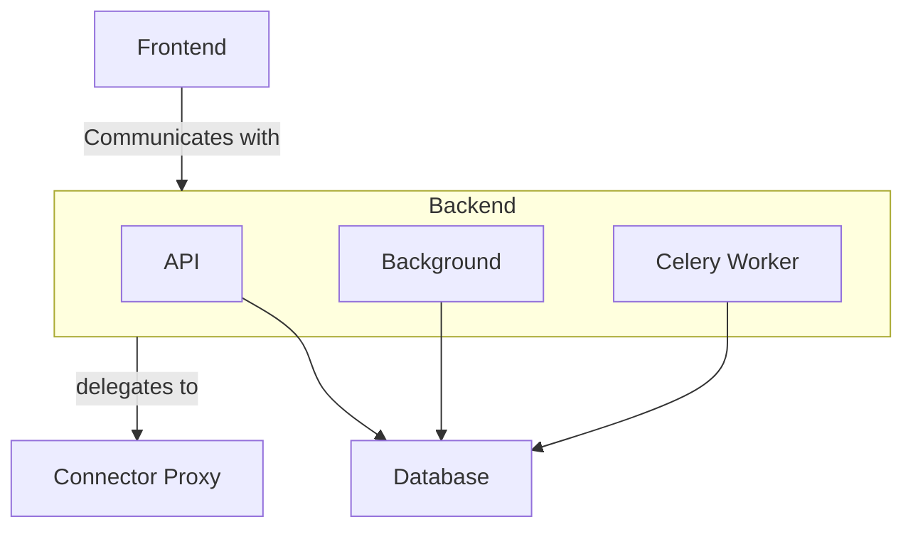

# Deploy

The minimal deployment is to mimic the docker-compose.yml file at the root of spiff-arena.
Steps for a more hardened production setup after that baseline include:

1. Setting up a MySQL or PostgreSQL database for Backend persistence (instead of SQLite)
2. Setting up a Redis/Valkey or RabbitMQ server for a Celery broker.
3. Separating out the Backend deployment into three deployments: 1) API, 2) Background, and 3) Celery worker.



API, Celery Worker, Connector Proxy, and Frontend can run any number of replicas.
The Background container is like a cron container, so it should run only one replica.

## Backend container commands

If you split Backend into API / Background / Celery worker containers, these are the entrypoints:

1. API (`spiffworkflow-backend`): `./bin/boot_server_in_docker` (image default)
2. Background (`spiffworkflow-backend-apscheduler`): `./bin/start_blocking_apscheduler`
3. Celery worker (`spiffworkflow-backend-worker`): `./bin/start_celery_worker`

Use the same backend env var set for all three containers, including Celery settings.
For the Celery configurations, see [Configure Celery Background Processing](/how_to_guides/deployment/work_with_redis_celery_broker).

You do not need container-specific Celery env var differences for this split; `./bin/start_celery_worker` sets worker-only runtime flags internally.

## Configuration

The app uses SQLAlchemy and supports MySQL, PostgreSQL, or SQLite.
Set `SPIFFWORKFLOW_BACKEND_DATABASE_URI` to the SQLAlchemy connection URL; Arena
infers the database type from that URL. `SPIFFWORKFLOW_BACKEND_DATABASE_TYPE`
selects the default connection configuration when no URI is supplied.
Check the `default.py` config file in the `spiffworkflow-backend/src/spiffworkflow_backend/config` directory for more env vars.

### Sentry

Set `SPIFFWORKFLOW_BACKEND_SENTRY_DSN` to send backend errors to Sentry. Without a DSN, Sentry is not initialized.

| Env var | Default | Purpose |
| --- | --- | --- |
| `SPIFFWORKFLOW_BACKEND_SENTRY_DSN` | empty | Sentry project DSN. |
| `SPIFFWORKFLOW_BACKEND_SENTRY_ENV_IDENTIFIER` | `SPIFFWORKFLOW_BACKEND_ENV` | Sentry environment name. |
| `SPIFFWORKFLOW_BACKEND_SENTRY_ERRORS_SAMPLE_RATE` | `1` | Fraction of errors to send. |
| `SPIFFWORKFLOW_BACKEND_SENTRY_TRACES_SAMPLE_RATE` | `0.01` | Fraction of transactions to trace. |
| `SPIFFWORKFLOW_BACKEND_SENTRY_ORGANIZATION_SLUG`, `SPIFFWORKFLOW_BACKEND_SENTRY_PROJECT_SLUG` | empty | Used to log a link to each captured API error in Sentry. |
| `SPIFFWORKFLOW_BACKEND_SENTRY_INCLUDE_LOCAL_VARIABLES` | `true` | Send the local variables of each stack frame with errors. |
| `SPIFFWORKFLOW_BACKEND_SENTRY_MAX_REQUEST_BODY_SIZE` | `medium` | How much of each request body to send: `never`, `small`, `medium`, or `always`. |

Errors from Celery background jobs are tagged with `process_instance_id` and `task_guid` when the job has them, so you can search for and alert on a single process instance.

Local variables and request bodies often contain process instance and task data, such as form submissions and service task responses.
If your processes handle regulated or sensitive data, such as health information, stop sending those fields with:

```sh
SPIFFWORKFLOW_BACKEND_SENTRY_INCLUDE_LOCAL_VARIABLES=false
SPIFFWORKFLOW_BACKEND_SENTRY_MAX_REQUEST_BODY_SIZE=never
SPIFFWORKFLOW_BACKEND_DATABASE_HIDE_PARAMETERS=true
```

`SPIFFWORKFLOW_BACKEND_DATABASE_HIDE_PARAMETERS` removes the parameter list that SQLAlchemy adds to SQL error messages, which otherwise includes the data being written.
It applies wherever those messages go, including logs, not only Sentry.
It does not change the error text from the database itself, which can quote a value, for example the duplicate key in a unique constraint error.

These settings cover only the fields above.
Events still include the request URL and query string, exception messages, and log records captured as breadcrumbs.
Keep sensitive values out of URLs and log messages, or configure data scrubbing in your Sentry project.

For trusted Python initialization code, see
[Python app extensions](/explanation/dev/app_extensions). Configuration and
operational instructions for individual extensions belong with their packages
in the process-model repository.
