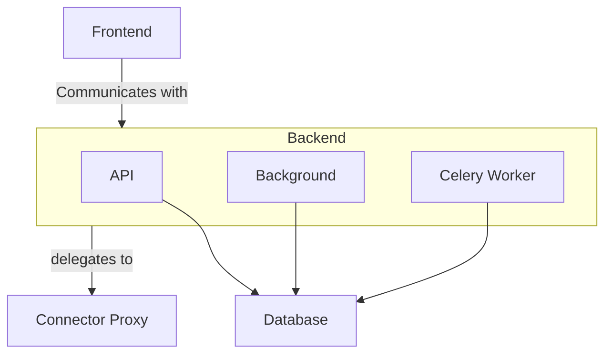

# Deploy

The minimal deployment is to mimic the docker-compose.yml file at the root of spiff-arena.
Steps for a more hardened production setup after that baseline include:

1. Setting up a MySQL or PostgreSQL database for Backend persistence (instead of SQLite)
2. Setting up a Redis/Valkey or RabbitMQ server for a Celery broker.
3. Separating out the Backend deployment into three deployments: 1) API, 2) Background, and 3) Celery worker.

API, Celery Worker, Connector Proxy, and Frontend can run any number of replicas.
The Background container is like a cron container, so it should run only one replica.

## Backend container commands

If you split Backend into API / Background / Celery worker containers, these are the entrypoints:

1. API (`spiffworkflow-backend`): `./bin/boot_server_in_docker` (image default)
2. Background (`spiffworkflow-backend-apscheduler`): `./bin/start_blocking_apscheduler`
3. Celery worker (`spiffworkflow-backend-worker`): `./bin/start_celery_worker`

Use the same backend env var set for all three containers, including Celery settings.
For the Celery configurations, see [Configure Celery Background Processing](/how_to_guides/deployment/work_with_redis_celery_broker).

You do not need container-specific Celery env var differences for this split; `./bin/start_celery_worker` sets worker-only runtime flags internally.

### Process models in worker containers

Every container that executes workflows needs a readable process-model directory at
`SPIFFWORKFLOW_BACKEND_BPMN_SPEC_ABSOLUTE_DIR`. Prefer an absolute path. The API container's checkout
is not automatically available in a separate Celery worker or background container.

Before importing the application or accepting jobs, the Celery worker prepares this directory:

* With `SPIFFWORKFLOW_BACKEND_GIT_CLONE_PROCESS_MODELS=true`, it uses the existing clone configuration
  to create a missing checkout. A checkout with a readable Git HEAD is retained without fetching,
  pulling, resetting, or discarding local changes. A nonempty directory without a checkout is refused.
* Otherwise, mount or bake the model directory into the worker image before startup. An unavailable,
  unreadable, or untraversable root prevents the worker from starting. Creating an empty placeholder
  directory does not supply the process models needed to execute jobs.

For clone-on-start, provide `SPIFFWORKFLOW_BACKEND_GIT_PUBLISH_CLONE_URL` and
`SPIFFWORKFLOW_BACKEND_GIT_SOURCE_BRANCH`, plus the existing SSH configuration when required by the
clone URL. HTTPS clones do not require an SSH key.

Plan model synchronization separately from startup. Updating the API's checkout through its Git
webhook does not update an independent worker checkout. Use your deployment's shared-volume or
reviewed checkout-update mechanism to converge all executors on the intended model revision. Check
for local or unpushed changes before replacing or updating checkouts. Apply equivalent model-directory
provisioning to background scheduler containers; their entrypoint does not clone models for them.

Before promoting a deployment, verify actual queued execution and save/resume behavior using a
synthetic in-progress instance, including preservation of saved answers across model updates or
restarts. A successful API request or Git webhook alone does not establish worker readiness.

## Configuration

The app uses sqlalchemy and supports mysql, postgres, or sqlite.
You must set `SPIFFWORKFLOW_BACKEND_DATABASE_TYPE` to one of these three values as well as setting `SPIFFWORKFLOW_BACKEND_DATABASE_URI`.
Check the `default.py` config file in the `spiffworkflow-backend/src/spiffworkflow_backend/config` directory for more env vars.
